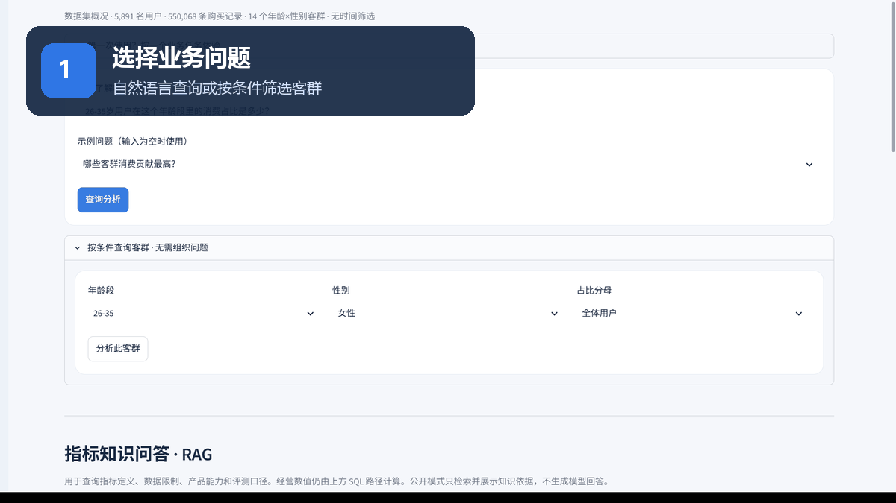
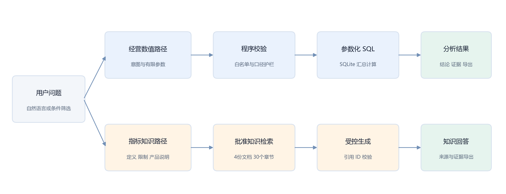

# Retail Insight · 零售经营分析助手

面向零售运营人员的 AI 数据产品原型：用自然语言查询客群贡献，以受控参数解析、参数化 SQL 和可引用 RAG 回答保证口径与证据可追溯。

[在线演示](https://ayra-retail-insight.streamlit.app/) · [4 页项目作品集 PDF](portfolio/RetailInsight_项目作品集.pdf) · [产品需求文档 PRD](docs/product_requirements.md) · [完整评测报告](reports/holdout_v1_report.md)

> 个人项目｜Python · SQL · SQLite · Streamlit · DeepSeek · RAG｜2026.08—2026.11
>
> 需求来自作品集场景假设，尚无实际企业客户、真实用户研究或业务收益验证。

## Demo 界面导览



公开演示使用 14 个核验汇总客群，支持规则查询、条件筛选和免费知识检索；配置 API Key 的本地增强版支持受控模型解析与带引用的 RAG 回答。

## 系统架构



- **经营数值路径：**模型只提取受控参数，不自由生成 SQL；程序完成白名单校验，再执行批准的参数化 SQL。
- **指标知识路径：**仅检索批准知识文档；回答必须通过引用 ID 校验，无依据问题在模型调用前拒答。
- **异常处理：**缺少条件时澄清，超出数据范围时拒答，模型或传输异常显式返回，不静默冒充成功。

## 核心评测结果

| 评测对象 | 方法 | 结果 |
| --- | --- | --- |
| 冻结查询集 | 20 题覆盖排名、同义表达、缺条件、双分母、越界问题与注入 | 规则版 **10/20**；模型＋程序校验 **20/20**；数值题 **6/6** 对账 |
| RAG 开发集 | 12 题检查目标章节、必要答案点、引用和无依据拒答 | 关键词检索 **12/12**；RAG v1 人工复核 **11/12** |
| 分母专项回归 | 10 题覆盖“全体”“年龄段内”“同龄人中”及双分母冲突 | 修复后 **10/10** |
| 模拟黑盒走查 | 5 个公开界面任务，记录完成情况与阻塞点 | 初始 **3 通过、1 失败、1 部分通过**；失败项已修复并回归 |

上述结果来自冻结验收集或开发集，不能外推为生产准确率。完整证据见[项目作品集](portfolio/RetailInsight_项目作品集.md)、[RAG 开发评测](reports/rag_dev_review.md)、[分母回归集](evals/denominator_regression.json)与[模拟黑盒报告](reports/simulated_blackbox_review_2026-10-28.md)。

## 产品流程

```text
业务问题 → 规则或模型提取有限参数 → 程序校验 → 批准的参数化 SQL
                                           ↓
                                SQLite → 结果、口径、证据、导出

知识问题 → 检索批准知识章节 → 受控模型回答 → 引用 ID 校验与证据导出
```

[项目作品集：在线阅读](portfolio/RetailInsight_项目作品集.md) · [PDF](portfolio/RetailInsight_项目作品集.pdf) · [Word](portfolio/RetailInsight_项目作品集.docx) · [RAG 知识库](knowledge/README.md) · [本地模型说明](docs/local_model_demo.md) · [用户试用方案](docs/user_trial_protocol.md)

## 网页演示

安装 `requirements.txt` 后，在项目根目录运行：

```powershell
python -m streamlit run app.py
```

没有本地数据库也可启动：自动使用经核验的14个年龄×性别客群汇总快照，保留当前指标查询。汇总来源为完整数据计算结果，不是模拟交易；公开模式不包含用户明细，也不提供实时查询。

示例：哪些客群消费贡献最高？26–35岁女性占该年龄段消费额多少？

[部署说明](docs/cloud_deployment.md) · [首版需求与验收](docs/ai_assistant_mvp.md) · [迭代记录](docs/product_iteration_log.md)

已发布规则版：https://ayra-retail-insight.streamlit.app/ 。本地升级功能不表示已经发布到该链接。

## 分析基础

基于 Kaggle 公开购买记录，使用 Python 分析消费行为、商品类别贡献与高消费用户特征。项目为个人分析练习，运营建议尚未经过真实实验验证。

## 数据来源

[Kaggle Black Friday Dataset](https://www.kaggle.com/datasets/aneeshamanke/black-friday-dataset)。包含 550,068 条购买记录、5,891 名用户和 3,631 个商品 ID。

下载并解压，将数据放在以下位置，保留文件名中的空格：

```text
data/raw/black-friday-dataset/BlackFriday dataset.csv
```

原始数据不随代码上传，请从来源页面自行下载。

## 核心发现

- 26–35 岁用户贡献约 39.9% 的全体消费额，该年龄段男性贡献约 31.18% 的全体消费额。
- 26–35 岁男性用户累计消费中位数为 682,712，女性为 461,253；男性减女性的中位数差值为 221,459，Bootstrap 95% 区间为 145,382.5–315,427.09。
- 累计消费额最高的约 20% 用户（1,178 人）贡献 55.33% 的总消费额。
- 商品主类别编码 1、5、8 合计贡献约 72.8% 的总消费额。
- B 类城市贡献约 41.5% 的总消费额。

详细发现和建议见 [分析报告](reports/findings.md)。金额按原始数据单位呈现。

## 图表展示


## 如何运行

使用 Python 3.12，在项目根目录打开终端并安装依赖：

```powershell
python -m pip install -r requirements.txt
```

确认数据放在上述路径后，运行数据审计：

```powershell
python .\01_data_audit.py
```

其他脚本也从项目根目录运行，例如：

```powershell
python .\14_gender_bootstrap.py
```

电脑装有多个 Python 时，可用实际可用的 Python 3.12 可执行文件路径替换 `python`。

## 脚本说明

| 脚本编号 | 内容 |
| --- | --- |
| 01–02 | 数据审计、类别检查 |
| 03–05 | 年龄、性别和用户级消费 |
| 06–07 | 商品类别分析与可视化 |
| 08–09 | 城市类别和用户级消费 |
| 10–11 | 用户消费集中度与帕累托图 |
| 12–13 | 高消费用户画像与可视化 |
| 14 | 男女用户累计消费中位数差异的 Bootstrap 分析 |
| 15 | 商品类别一致性与缺失可恢复性审计 |
| 16 | 用户级类别共现、支持度、置信度和提升度 |
| 17 | 按用户购买记录数四分位分层的敏感性检查 |

`reports/` 保存图表与结论，`requirements.txt` 列出依赖。`notebooks/` 预留用于后续笔记，目前分析由 Python 脚本完成。

## 类别关联扩展

商品类别审计发现，同一商品 ID 的已知类别没有冲突，但类别 2、3 的缺失均无法通过同商品其他记录恢复，因此保留缺失，使用完整的主类别进行共现分析。

以用户为单位，将是否购买过某主类别编码为布尔值。探索性筛选采用共同购买人数至少 100 人、支持度至少 2%，不是显著性检验。类别 17 与 18 的共同购买人数为 237，支持度为 4.02%，17 → 18 的置信度为 55.63%，提升度为 2.55。

按购买记录数四分位分层后，17 → 18 的提升度分别为 1.88、1.88、1.72、1.46，均低于整体值；最低记录数组仅有 2 名共同购买用户。结果提示关联对用户购买记录数差异敏感，仍属探索性线索，不代表稳定推荐规则、购买先后顺序或同单搭配。

输出见 `reports/product_category_audit.csv`、`reports/user_category_rules_filtered.csv` 与 `reports/cooccurrence_sensitivity.csv`。

## 分析限制

- 无订单编号，购买记录数不能直接解释为订单数或购物频次，也不能确认真实同单购物篮。
- 无日期字段，无法分析时间趋势或计算完整 RFM 指标。
- 商品类别经过脱敏，不能推断具体商品类型；类别 2、3 的缺失含义仍需确认。
- 群体差异不代表因果关系，Bootstrap 区间依赖抽样假设。
- 运营建议为待验证假设，不代表已实现的销售提升。
